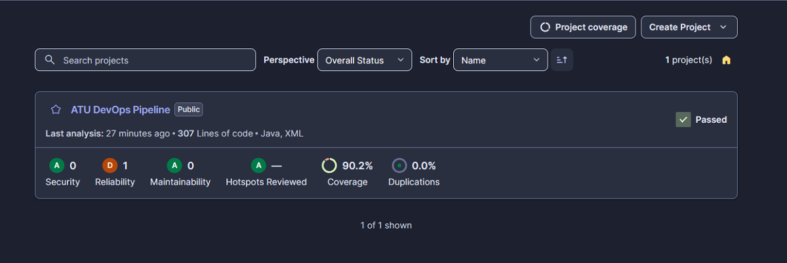
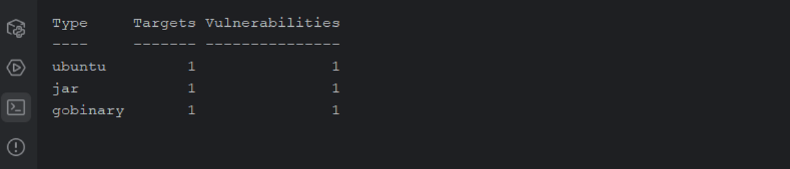
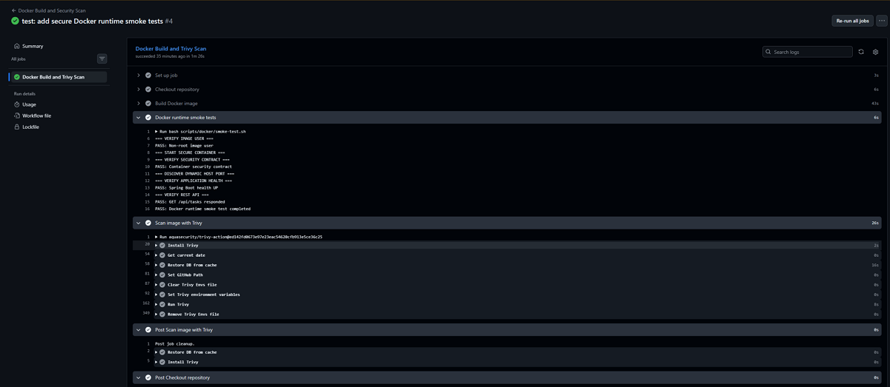
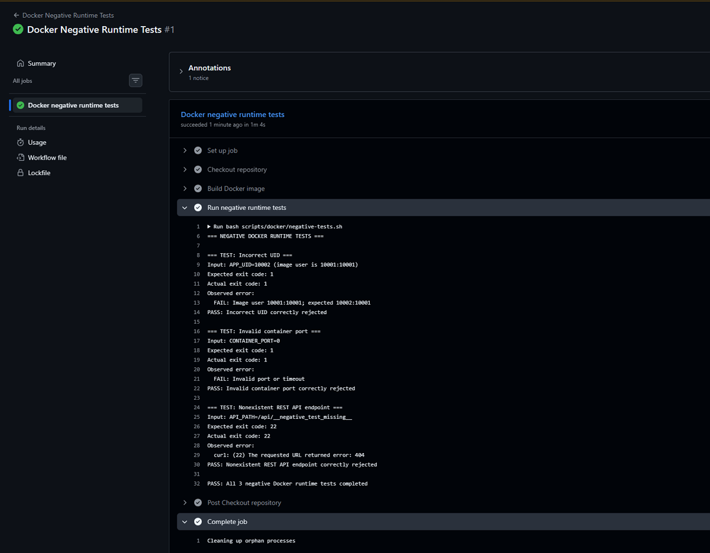
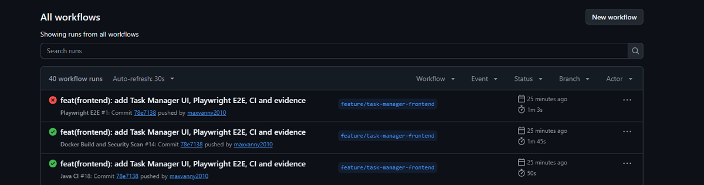
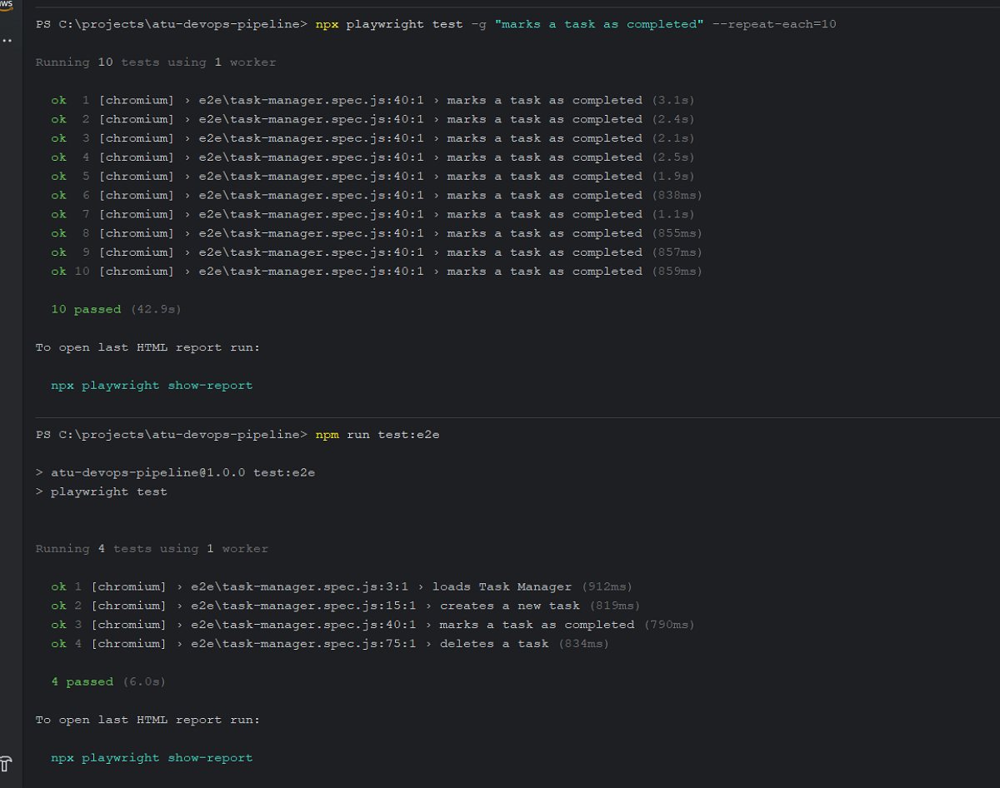

### DevSecOps CI/CD Pipeline for a Spring Boot Task Manager

**Atlantic Technological University (ATU)**

**Programme:** Postgraduate Diploma in Computing in DevOps<br/>
**Module:** DevOps Software Engineering<br/>
**Lecturer:** Maria Griffin<br/>
**Student:** Maksym Voronianskyi<br/>
**Student Number:** L00213593<br/>
**Academic Year:** 2026/2027

**Technologies:** Java 21, Spring Boot, Spring Data JPA, H2, Maven,<br/>
JUnit, Mockito, Spring Boot Test, JaCoCo, HTML, CSS, JavaScript,<br/>
Playwright, Git, GitHub, GitHub Actions, SonarQube, Trivy,<br/>
Dependabot, Docker, Docker Compose, GitHub Container Registry<br/>
(GHCR), Kubernetes, Kustomize, Terraform, Spring Boot Actuator,<br/>
Micrometer, Prometheus, Grafana, Slack, SBOM, Software Provenance,<br/>
Image Signing, Conventional Commits, Semantic Versioning

---

### Overview

This project develops an automated DevSecOps CI/CD pipeline for a<br/>
small Spring Boot Task Manager web application.

The application is intentionally limited in scope so that the<br/>
project can focus on reproducible builds, automated testing, secure<br/>
software delivery, container orchestration, monitoring, and recovery<br/>
procedures.

**Assignment:** Task 3 - DevOps in Action: Creating a mini-pipeline<br/>
(60%).<br/>
**Related assignment:** Task 4 - DevOps in Action: Reflection (10%).

#### Project Status

The REST API, Maven tests, JaCoCo gate, Java CI, SonarQube, and Docker<br/>
build have passed verification. Docker smoke and manual negative tests<br/>
also passed in GitHub Actions. Dependabot opened four update PRs.<br/>
The Task Manager frontend and all four Playwright E2E tests passed<br/>
locally and in GitHub Actions on 18 November 2026.

#### Technology Stack

| Area                     | Technologies                              |
|--------------------------|-------------------------------------------|
| Backend                  | Java 21, Spring Boot, Spring Data JPA, H2 |
| Frontend                 | HTML, CSS, JavaScript                     |
| Build and dependencies   | Maven, Dependabot                         |
| Unit and API testing     | JUnit, Mockito, Spring Boot Test          |
| Coverage                 | JaCoCo                                    |
| Browser testing          | Playwright                                |
| Source control and CI/CD | Git, GitHub, GitHub Actions               |
| Code quality             | SonarQube                                 |
| Container security       | Docker, Docker Compose, Trivy             |
| Image distribution       | GHCR, SBOM, provenance, image signing     |
| Orchestration and IaC    | Kubernetes, Kustomize, Terraform          |
| Observability            | Actuator, Micrometer, Prometheus, Grafana |
| Notifications            | Slack                                     |
| Release management       | Conventional Commits, Semantic Versioning |

The technology list describes the overall project scope. Individual<br/>
implementation and validation states are recorded in the sections<br/>
below.

#### Application Scope

The REST API uses Spring Boot 4.1.2, Spring Data JPA, and H2. A small<br/>
HTML, CSS, and JavaScript frontend is served by Spring Boot from<br/>
`src/main/resources/static/`. It uses the existing REST API without a<br/>
separate frontend service.

| Method | Endpoint          | Description        |
|--------|-------------------|--------------------|
| GET    | `/api/tasks`      | List all tasks     |
| GET    | `/api/tasks/{id}` | Get a task by ID   |
| POST   | `/api/tasks`      | Create a task      |
| PATCH  | `/api/tasks/{id}` | Update task status |
| DELETE | `/api/tasks/{id}` | Delete a task      |

Bean Validation checks requests. Invalid data and missing tasks<br/>
receive HTTP 400 and 404 responses where applicable. The backend<br/>
uses controller, service, and repository layers.

#### Pipeline Architecture

The delivery design separates Pull Request validation from trusted<br/>
release and deployment operations.

1. Develop on a feature branch and open a Pull Request.
2. Execute builds, unit tests, integration tests, and browser tests.
3. Enforce coverage, code quality, and security gates.
4. Build and runtime-test a hardened Docker image.
5. Scan the image and establish traceable release artifacts.
6. Publish the verified image to GHCR by immutable digest.
7. Deploy to Kubernetes through a controlled workflow.
8. Verify health, metrics, alerts, and rollback procedures.

#### Git Workflow

- `master` is the integration branch.
- Feature branches isolate implementation changes.
- Pull Requests document changes and verification results.
- Commits are identified by Git SHA; pushes and PRs do not create
  versions.
- Release tags identify validated application versions.

#### Testing Strategy

| Test level     | Purpose                           | Result                |
|----------------|-----------------------------------|-----------------------|
| Unit           | Validate service logic            | ![PASS][pass]         |
| Integration    | Validate application components   | ![PASS][pass]         |
| REST API       | Validate backend HTTP behaviour   | ![PASS][pass]         |
| JaCoCo gate    | Enforce minimum 80% coverage      | ![PASS][pass]         |
| Docker runtime | Validate hardened runtime locally | ![PASS][pass]         |
| Frontend E2E   | Validate browser workflows        | Local and CI 4/4 PASS |
| Kubernetes     | Validate rollout and rollback     | Not verified          |

**Local backend validation (17 November 2026):** Nine tests passed:<br/>
four service unit tests, four MVC API integration tests, and one<br/>
application context test. Maven verification and the JaCoCo gate<br/>
passed.

#### Task Manager Frontend and Playwright E2E

The frontend provides a task form, task list, completion checkboxes,<br/>
delete buttons, refresh, counters, and error messages. It calls the<br/>
Spring Boot API using `fetch` on the same origin. The browser UI does<br/>
not require React, a separate server, or CORS configuration.

| File                                   | Purpose                       |
|----------------------------------------|-------------------------------|
| `src/main/resources/static/index.html` | Page structure and form       |
| `src/main/resources/static/styles.css` | Responsive layout and styling |
| `src/main/resources/static/app.js`     | REST requests and UI updates  |
| `e2e/task-manager.spec.js`             | Four Chromium E2E tests       |
| `playwright.config.js`                 | Test configuration, port 8081 |
| `package.json`, `package-lock.json`    | Test scripts and dependencies |

Run the backend locally and execute the browser tests in another<br/>
terminal:

```powershell
mvn spring-boot:run "-Dspring-boot.run.arguments=--server.port=8081"
npm ci
npx playwright install chromium
npm run test:e2e
```

Open the UI at `http://localhost:8081/` while Spring Boot is running.<br/>
The E2E tests use a real browser and API requests to create and clean<br/>
up test data. No external application server is required.

| Playwright test (18 November 2026) | Local result  |
|------------------------------------|---------------|
| Load Task Manager                  | ![PASS][pass] |
| Create a task                      | ![PASS][pass] |
| Mark a task as completed           | ![PASS][pass] |
| Delete a task                      | ![PASS][pass] |

**Local result:** 4/4 passed in Chromium in 8.4 seconds. JavaScript<br/>
syntax checks, test discovery, and `actionlint` validation of the new<br/>
workflow also passed. These do not establish a GitHub Actions PASS.

The separate `.github/workflows/playwright.yml` builds Spring Boot,<br/>
starts it on port 8081, waits for `/actuator/health`, installs Chromium,<br/>
runs the E2E tests, and uploads reports and the application log.<br/>
**CI status:** PASS (4/4 tests after fixing a timing issue).

#### JaCoCo Code Coverage

JaCoCo 0.8.16 measures coverage during Maven verification.

| Validation                    | Result        |
|-------------------------------|---------------|
| Nine automated tests          | ![PASS][pass] |
| Instruction coverage: 88%     | ![PASS][pass] |
| Minimum instruction gate: 80% | ![PASS][pass] |

HTML report: `target/site/jacoco/index.html`.


#### GitHub Actions CI

The Java workflow is defined in `.github/workflows/ci.yml`. It uses<br/>
Java 21, Maven verification, and the JaCoCo 80% coverage gate.

| Validation                               | Result        |
|------------------------------------------|---------------|
| Local actionlint validation              | ![PASS][pass] |
| GitHub Actions run `44083764858`         | ![PASS][pass] |
| Test and coverage report artifact upload | ![PASS][pass] |

The workflow handles PRs and branch pushes and uploads test<br/>
artifacts.

#### SonarQube Static Analysis

SonarQube identified a reliability issue (`java:S9427`) in an API<br/>
test. A Java `assert` was replaced with JUnit `assertNotNull()`.<br/>
Re-analysis confirmed the issue was resolved.

**Before: Reliability D, 1 open issue**



**After: Reliability A, 0 open issues**


| Validation                   | Result        |
|------------------------------|---------------|
| SonarQube Quality Gate       | ![PASS][pass] |
| Coverage: 90.2%              | ![PASS][pass] |
| Duplications: 0.0%           | ![PASS][pass] |
| Reliability A, 0 open issues | ![PASS][pass] |

#### Dependency and Workflow Security

Resolved dependency updates were verified locally: H2 `2.5.252`,<br/>
json-smart `2.6.1`, and ASM `9.11.1` in test scope. Jackson Databind<br/>
`3.1.7` was retained.

Workflow security and maintenance controls include:

- Explicit minimal job permissions (`contents: read`).
- Full commit SHA pinning for GitHub Actions dependencies.
- Concurrency groups to cancel superseded CI runs.
- Dependabot configuration for Maven, Docker, and GitHub Actions.
- Weekly dependency update checks and reviewable update requests.

Dependabot created four update PRs after the Docker work was merged<br/>
into `master`. Each PR was checked by the existing CI workflows.

#### Docker Containerisation and Security Scanning

A three-stage Dockerfile packages the Task Manager application:

1. **Build:** Maven and Java 21 compile and verify the application.
2. **Extract:** Spring Boot extracts the layered executable JAR.
3. **Runtime:** Java 21 JRE runs without Maven, JDK, or project sources.

Separating application code and dependencies improves image layer<br/>
caching.

**Runtime security contract:**

- Non-root application user and group: `10001:10001`.
- Read-only root filesystem.
- All Linux capabilities dropped.
- Privilege escalation disabled with `no-new-privileges`.
- Writable `/app/tmp` with `rw,nosuid,noexec` tmpfs restrictions.
- Localhost-only published host port during smoke testing.

#### Trivy Container Security Scan

Trivy 0.76.2 scanned the image and Java dependencies. No HIGH or<br/>
CRITICAL vulnerabilities were detected in the verified scan. The<br/>
security gate returned exit code 0.



| Validation                           | Result        |
|--------------------------------------|---------------|
| Local image build and layered JAR    | ![PASS][pass] |
| Local Trivy scan                     | ![PASS][pass] |
| No HIGH or CRITICAL findings         | ![PASS][pass] |
| Trivy security gate (`exit-code: 1`) | ![PASS][pass] |
| GitHub Actions run `44162103286`     | ![PASS][pass] |

The cited GitHub Actions run verifies Docker build and Trivy<br/>
scanning, not the newer runtime smoke-test step.

#### Docker Runtime Smoke Tests

The Docker security workflow calls `scripts/docker/smoke-test.sh`<br/>
against the image built earlier in the same job. Test logic remains<br/>
in a reusable Bash script rather than embedded inside the GitHub<br/>
Actions YAML.

The script verifies the image user and Docker runtime configuration,<br/>
starts the application on a dynamically allocated localhost port,<br/>
checks the HTTP endpoints, and removes the test container on exit.

| Local validation (18 November 2026) | Result        |
|-------------------------------------|---------------|
| Bash syntax                         | ![PASS][pass] |
| Docker image build                  | ![PASS][pass] |
| Non-root image user                 | ![PASS][pass] |
| Runtime security restrictions       | ![PASS][pass] |
| Dynamic host port discovery         | ![PASS][pass] |
| Spring Boot `/actuator/health`      | ![PASS][pass] |
| REST API `GET /api/tasks`           | ![PASS][pass] |

The security checks use `docker inspect`. On failure, the script<br/>
prints container logs and removes the temporary container.

The API check is a smoke test, not full JSON schema validation. The<br/>
runtime smoke test passed in GitHub Actions.

#### Docker Runtime Smoke Test Evidence




#### Negative Docker Runtime Tests

The separate workflow `.github/workflows/docker-negative-tests.yml`<br/>
runs only when started manually from GitHub Actions. It builds the<br/>
image and runs `scripts/docker/negative-tests.sh`.

| Scenario               | Observed failure       | Result        |
|------------------------|------------------------|---------------|
| Incorrect UID          | Exit 1; UID mismatch   | ![PASS][pass] |
| Invalid container port | Exit 1; rejected value | ![PASS][pass] |
| Missing API endpoint   | HTTP 404; exit 22      | ![PASS][pass] |

All three cases passed in the manual GitHub Actions run on<br/>
18 November 2026. Each test checked the actual exit code and error<br/>
message, rather than accepting a printed `PASS` alone.



#### Dependabot Update Verification

Dependabot opened four update PRs after the Docker changes reached<br/>
`master`. The PRs triggered the same Java and Docker checks as other<br/>
code changes. No dependency update was merged as part of this review.


One proposal, PR #6, changed the runtime image from Java 21 to Java 24.<br/>
Java CI passed, but the Docker scan failed. Trivy reported 16 HIGH<br/>
findings and no CRITICAL findings in the Ubuntu 24.04 image. The scan<br/>
returned exit code 1, leaving the PR with a failing check.

| PR #6 validation                    | Observed result             |
|-------------------------------------|-----------------------------|
| Java CI                             | ![PASS][pass]               |
| Docker build and runtime smoke test | ![PASS][pass]               |
| Trivy scan                          | 16 HIGH, 0 CRITICAL; exit 1 |
| Security gate                       | Failed the Docker CI check  |


A failed check does not by itself prevent someone from pressing Merge.<br/>
Enforcing a merge block requires a branch ruleset or protection rule.

#### Monitoring and Logging

The delivery architecture includes Spring Boot Actuator and<br/>
Micrometer, Prometheus metrics collection, Grafana dashboards,<br/>
structured logs, alerts, and Slack notifications. Their end-to-end<br/>
deployment and verification have not yet been completed.

#### Assignment Requirements and Evidence

| Assessment criterion               | Marks | Evidence                       |
|------------------------------------|------:|--------------------------------|
| Source Code Management             |    10 | Git history and Pull Requests  |
| Automated Builds and Testing       |    20 | CI results and test reports    |
| Static Analysis and Security       |    15 | Quality and scan reports       |
| Containerisation and Orchestration |    20 | Docker and Kubernetes evidence |
| Deployment                         |    20 | CD runs and deployment checks  |
| Monitoring and Logging             |    15 | Dashboards, alerts, and logs   |

Only observed results are described as verified.

#### Documentation

- [Architecture](docs/ARCHITECTURE.md)
- [Reflection Notes](docs/REFLECTION_NOTES.md)

#### References

- [GitHub Actions](https://docs.github.com/en/actions)
- [JaCoCo Maven Plugin](https://www.jacoco.org/jacoco/trunk/doc/maven.html)
- [GitHub Engineering: Dependabot][github-dependabot]
- [Reddit Engineering: Dependency management][reddit-dependencies]
- [GitHub Dependabot Documentation][dependabot-docs]

Reddit Engineering describes previous Dependabot usage and migration<br/>
to Renovate; it is not evidence of current Reddit production use of<br/>
Dependabot.

#### Playwright CI Failure and Fix Evidence

The first Playwright GitHub Actions run passed three of four tests.
The completion test failed because it checked the API state before
waiting for the asynchronous HTTP PATCH response.

The test was updated to wait for the matching PATCH response
before verifying the persisted task status.

| Verification               | Result              |
|----------------------------|---------------------|
| Initial GitHub Actions run | FAIL: 3/4           |
| Repeated completion test   | PASS: 10/10 locally |
| Full E2E suite after fix   | PASS: 4/4 locally   |
| GitHub Actions after fix   | PASS: 4/4 E2E       |







#### Development Status and Limitations

Backend tests, quality checks, Docker build, positive smoke tests,<br/>
Trivy scanning, and manual negative tests are verified in GitHub<br/>
Actions. Dependabot PR creation is verified. Frontend E2E tests passed<br/>
locally (4/4) and in GitHub Actions. Kubernetes, release automation, supply-chain<br/>
attestations, and observability remain unverified.

[pass]: https://img.shields.io/badge/PASS-2ea44f?style=flat-square

[github-dependabot]: https://github.blog/engineering/platform-security/

[reddit-dependencies]: https://www.reddit.com/r/RedditEng/

[dependabot-docs]: https://docs.github.com/en/code-security

### Release automation scripts

The release workflow controls the order of the Verify and Publish jobs.
Longer Bash commands are stored in `scripts/release/` so they can be
checked without running a release.
They can be syntax-checked independently with `bash -n` and ShellCheck.

The Verify job runs Maven/JaCoCo, Playwright, Docker smoke tests, and Trivy.
After the security gate, it exports the tested Docker image as an artifact.
The Publishing job checks the master SHA again, verifies the transferred
archive checksum, loads that image without rebuilding, pushes GHCR version
and commit SHA tags, and creates the GitHub Release with its image digest.

A release is triggered by a stable SemVer tag such as `v0.1.0` pointing to
the current `master` commit. No image is published from pull requests.
This workflow has not been exercised by a real tag yet.

### Release Security Hardening and Offline Checks

The release pipeline uses a separate read-only Verify job and a privileged
Publishing job. The candidate image name is configured once in `release.yml`.
Verify runs Java, Playwright, Docker smoke tests and Trivy. Its image is
saved with an image ID, and both files are covered by SHA-256 checksums.
Publish checks the transferred image ID, full Git revision and source label.

Before publication, the pipeline refuses an existing GitHub Release or
GHCR version/SHA tag and checks the current master commit again.
These preflight checks reduce accidental overwrites, but do not guarantee
registry-level tag immutability against concurrent writers.

Run the offline checks without cloud access:

```bash
bash scripts/release/test-release-scripts.sh
```

Also run `actionlint .github/workflows/release.yml` and syntax checks
for all release scripts. The tests use mocked services; an actual
GitHub Actions release remains unverified until a tagged run succeeds.
