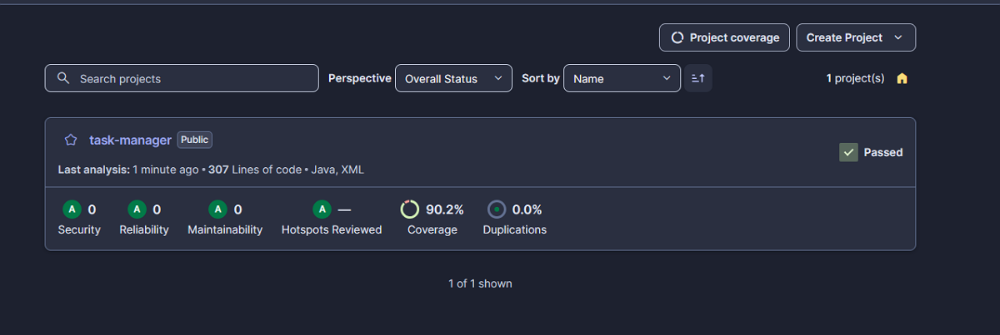

### DevSecOps CI/CD Pipeline for a Spring Boot Task Manager

**Atlantic Technological University (ATU)**

**Program:** Postgraduate Diploma in Computing in DevOps 
**Module:** DevOps Software Engineering 
**Lecturer:** Maria Griffin 
**Student:** Maksym Voronianskyi 
**Student Number:** L00213593 
**Academic Year:** 2026/2027

**Technologies:** Java 21, Spring Boot, Maven, GitHub Actions, SonarQube, Trivy, 
Docker, Kubernetes, Terraform, Playwright, Prometheus, Grafana, Slack

---

### Overview

This project develops an automated DevSecOps CI/CD pipeline for a small Spring 
Boot Task Manager web application.

The application is intentionally limited in scope so that the project can focus on 
reproducible builds, automated testing, secure software delivery, container 
orchestration, monitoring, and recovery procedures.

**Assignment:** Task 3 - DevOps in Action: Creating a mini-pipeline (60%). 
**Related assignment:** Task 4 - DevOps in Action: Reflection (10%).

#### Project Status

**Current phase:** REST API, automated tests, JaCoCo and GitHub Actions CI verified. 
Local SonarQube analysis passed; frontend, deployment and monitoring are planned.

#### Technologies

| Area                         | Selected Technologies                 |
|------------------------------|---------------------------------------|
| Application                  | Java 21, Spring Boot, Maven           |
| Frontend                     | HTML, CSS, JavaScript                 |
| Unit and integration testing | JUnit, Mockito, Spring Boot Test      |
| Frontend and E2E testing     | Playwright                            |
| Test coverage                | JaCoCo                                |
| CI/CD                        | GitHub Actions                        |
| Code quality                 | SonarQube                             |
| Security scanning            | Trivy, secret scanning                |
| Containerisation             | Docker                                |
| Orchestration                | Kubernetes                            |
| Infrastructure as Code       | Terraform                             |
| Observability                | Prometheus, Grafana, application logs |
| Notifications                | Slack                                 |

#### Application Scope

The REST API is implemented using Spring Boot 4.1.2, Spring Data JPA and H2. 
The browser-based interface remains planned.

| Method | Endpoint          | Description        |
|--------|-------------------|--------------------|
| GET    | `/api/tasks`      | List all tasks     |
| GET    | `/api/tasks/{id}` | Get a task by ID   |
| POST   | `/api/tasks`      | Create a task      |
| PATCH  | `/api/tasks/{id}` | Update task status |
| DELETE | `/api/tasks/{id}` | Delete a task      |

Requests use Bean Validation; invalid data and missing tasks receive HTTP 400/404. 
The API uses controller, service and repository layers.

#### Pipeline Architecture

The planned CI/CD process separates Pull Request validation from trusted 
deployment operations.

1. Create a feature branch and open a GitHub Pull Request.
2. Run automated build, unit tests, integration tests, and frontend tests.
3. Apply code quality and security checks before merging.
4. Build and scan a multi-stage Docker image.
5. Publish the verified image with an immutable identifier.
6. Deploy to a local Kubernetes environment through a controlled workflow.
7. Verify application health, observe metrics, and test rollback procedures.
8. Capture logs, alerts, pipeline results, and evidence for the assignment.

#### Git Workflow

- `master` is the integration branch.
- Feature branches isolate implementation changes.
- Pull Requests document changes, tests, and review outcomes.
- Each commit is identified by its Git SHA; pushes and PRs do not create versions.
- Release tags will identify validated application versions after CI is configured.

#### Testing Strategy

| Test Level     | Purpose                                      | Status  |
|----------------|----------------------------------------------|---------|
| Unit           | Validate isolated application logic          | Passed  |
| Integration    | Validate application components together     | Passed  |
| API            | Validate REST endpoint behaviour             | Passed  |
| Frontend / E2E | Validate browser-based user workflows        | Planned |
| Security       | Detect vulnerable dependencies and images    | Planned |
| Deployment     | Validate rollout, health checks and rollback | Planned |

**Local validation (17 November 2026):** `mvn clean test` — BUILD SUCCESS. 
9 tests passed: 4 service unit, 4 API integration and 1 context-load test. 
JaCoCo 80% gate and GitHub Actions CI run `44083764858` passed.

Verified evidence is shown below and stored under `evidence/`.

#### JaCoCo Code Coverage

JaCoCo 0.8.16 measures Java test coverage during Maven verification.

- Automated tests: 9 passed, 0 failures.
- Instruction coverage: **88%**.
- Quality Gate: minimum **80%**, passed.
- HTML report: `target/site/jacoco/index.html`.

#### GitHub Actions CI

The CI workflow is defined in `.github/workflows/ci.yml`. 
It runs Java 21, Maven verification, and the JaCoCo 80% coverage gate.

- Triggers: PRs to `master`, pushes to `master` and `feature/**`, manual runs.
- Test and coverage reports are uploaded as workflow artifacts.
- Local workflow validation: **actionlint PASS**.
- GitHub Actions run `44083764858`: **passed**; reports uploaded as artifacts.

**Reference:** [GitHub Actions](https://docs.github.com/en/actions)

#### Security and Supply Chain Controls

The planned controls include:

- Read-only default permissions for GitHub Actions jobs.
- Separation of untrusted Pull Request checks from deployment credentials.
- Static analysis and vulnerability scanning with enforced quality gates.
- Minimal Docker runtime privileges and multi-stage builds.
- Software Bill of Materials (SBOM) generation.
- Immutable container image digests and provenance where supported.
- Protected deployment configuration and restricted secret access.

**Dependency remediation verified locally:** H2 `2.4.240` → `2.5.252`; 
json-smart `2.6.0` → `2.6.1`; ASM `9.7.1` → `9.11.1` (test scope). 
Jackson Databind `3.1.7` was retained. Maven dependency resolution and tests passed. 
A full vulnerability scan and enforced security gate remain planned.

#### SonarQube Static Analysis

SonarQube identified a reliability issue (`java:S9427`) in an
integration test. The Java `assert` was replaced with JUnit's
`assertNotNull()`. A subsequent analysis confirmed the issue was resolved.

**Before - Reliability D, 1 Open Issue**

**After - Reliability A, 0 Open Issues**

The Quality Gate passed with 90.2% coverage and 0.0% duplications.

#### Containerisation and Deployment

The application will use Docker for packaging and local Kubernetes for 
orchestration. Infrastructure and deployment configurations will be kept in 
version control to support reproducibility.

Deployment validation will include readiness and liveness checks, smoke tests, and 
a documented rollback experiment.

#### Monitoring and Logging

The observability stack is planned to include:

- Spring Boot Actuator and Micrometer metrics.
- Prometheus metrics collection.
- Grafana dashboards for application health.
- Structured application logs.
- Alerting and Slack notifications.

#### Assignment Requirements and Evidence

| Assessment Criterion               | Marks | Evidence Location                 |
|------------------------------------|------:|-----------------------------------|
| Source Code Management             |    10 | Git history and Pull Requests     |
| Automated Builds and Testing       |    20 | CI results and test reports       |
| Static Analysis and Security       |    15 | Quality and vulnerability reports |
| Containerisation and Orchestration |    20 | Docker and Kubernetes evidence    |
| Deployment                         |    20 | CD runs and deployment checks     |
| Monitoring and Logging             |    15 | Dashboards, alerts, and logs      |

Evidence links and verified outcomes will be added as the project progresses. No 
test or deployment result is claimed before successful validation.

#### Documentation

- [Architecture](docs/ARCHITECTURE.md)
- [Reflection Notes](docs/REFLECTION_NOTES.md)

Pipeline test results, security evidence, and deployment outcomes will be 
documented in this README and linked to files in `evidence/`.

#### References

Official technical and academic sources will be added when the related 
implementation decisions and controls are documented and validated.

- [JaCoCo Maven Plugin](https://www.jacoco.org/jacoco/trunk/doc/maven.html)

#### Development Status and Limitations

The REST API and nine automated tests have passed local validation. 
JaCoCo, GitHub Actions CI and local SonarQube analysis have been verified. 
The frontend, container delivery, monitoring and a full vulnerability gate 
remain unimplemented or unverified.
