### DevSecOps CI/CD Pipeline for a Spring Boot Task Manager

**Atlantic Technological University (ATU)**

**Programme:** Postgraduate Diploma in Computing in DevOps **Module:** DevOps<br/>
Software Engineering **Lecturer:** Maria Griffin **Student:** Maksym<br/>
Voronianskyi **Student Number:** L00213593 **Academic Year:** 2026/2027

**Technologies:** Java 21, Spring Boot, Spring Data JPA, H2, Maven, JUnit,<br/>
Mockito, Spring Boot Test, JaCoCo, HTML, CSS, JavaScript, Playwright, Git,<br/>
GitHub, GitHub Actions, SonarQube, Trivy, Dependabot, Docker, Docker Compose,<br/>
GitHub Container Registry (GHCR), Kubernetes, Kustomize, Terraform, Spring Boot<br/>
Actuator, Micrometer, Prometheus, Grafana, Slack, SBOM, Software Provenance,<br/>
Image Signing, Conventional Commits, Semantic Versioning

---

### Overview

This project develops an automated DevSecOps CI/CD pipeline for a small Spring<br/>
Boot Task Manager web application.

The application is intentionally limited in scope so that the project can focus<br/>
on reproducible builds, automated testing, secure software delivery, container<br/>
orchestration, monitoring, and recovery procedures.

**Assignment:** Task 3 - DevOps in Action: Creating a mini-pipeline (60%).<br/>
**Related assignment:** Task 4 - DevOps in Action: Reflection (10%).

#### Project Status

The REST API, Maven tests, JaCoCo gate, Java CI, SonarQube, and Docker build<br/>
have passed verification. Docker smoke and manual negative tests also passed in<br/>
GitHub Actions. Dependabot opened four update PRs. The Task Manager frontend<br/>
and all four Playwright E2E tests passed locally and in GitHub Actions on 18<br/>
November 2026. The first successful tagged release, `v0.1.1`, was published to<br/>
GHCR on 19 November 2026.

#### Technology Stack

| Area                     | Technologies                              |
|--------------------------|-------------------------------------------|
| Backend                  | Java 21, Spring Boot, Spring Data JPA, H2 |
| Frontend                 | HTML, CSS, JavaScript                     |
| Build and dependencies   | Maven, Dependabot                         |
| Unit and API testing     | JUnit, Mockito, Spring Boot Test          |
| Coverage                 | JaCoCo                                    |
| Browser testing          | Playwright                                |
| Source control and CI/CD | Git, GitHub, GitHub Actions               |
| Code quality             | SonarQube                                 |
| Container security       | Docker, Docker Compose, Trivy             |
| Image distribution       | GHCR, SBOM, provenance, image signing     |
| Orchestration and IaC    | Kubernetes, Kustomize, Terraform          |
| Observability            | Actuator, Micrometer, Prometheus, Grafana |
| Notifications            | Slack                                     |
| Release management       | Conventional Commits, Semantic Versioning |

The technology list describes the overall project scope. Individual<br/>
implementation and validation states are recorded in the sections below.

#### Application Scope

The REST API uses Spring Boot 4.1.2, Spring Data JPA, and H2. A small HTML,<br/>
CSS, and JavaScript frontend is served by Spring Boot from<br/>
`src/main/resources/static/`. It uses the existing REST API without a separate<br/>
frontend service.

| Method | Endpoint          | Description        |
|--------|-------------------|--------------------|
| GET    | `/api/tasks`      | List all tasks     |
| GET    | `/api/tasks/{id}` | Get a task by ID   |
| POST   | `/api/tasks`      | Create a task      |
| PATCH  | `/api/tasks/{id}` | Update task status |
| DELETE | `/api/tasks/{id}` | Delete a task      |

Bean Validation checks requests. Invalid data and missing tasks receive HTTP<br/>
400 and 404 responses where applicable. The backend uses controller, service,<br/>
and repository layers.

#### Pipeline Architecture

The delivery design separates Pull Request validation from trusted release and<br/>
deployment operations.

1. Develop on a feature branch and open a Pull Request.
2. Execute builds, unit tests, integration tests, and browser tests.
3. Enforce coverage, code quality, and security gates.
4. Build and runtime-test a hardened Docker image.
5. Scan the image and establish traceable release artifacts.
6. Publish the verified image to GHCR by immutable digest.
7. Deploy to Kubernetes through a controlled workflow.
8. Verify health, metrics, alerts, and rollback procedures.

#### Git Workflow

- `master` is the integration branch.
- Feature branches isolate implementation changes.
- Pull Requests document changes and verification results.
- Commits are identified by Git SHA; pushes and PRs do not create
  versions.
- Release tags identify validated application versions.

#### Testing Strategy

| Test level     | Purpose                         | Result                         |
|----------------|---------------------------------|--------------------------------|
| Unit           | Validate service logic          | ![PASS][pass]                  |
| Integration    | Validate application components | ![PASS][pass]                  |
| REST API       | Validate backend HTTP behaviour | ![PASS][pass]                  |
| JaCoCo gate    | Enforce 80% minimum coverage    | ![PASS][pass]                  |
| Docker runtime | Validate hardened runtime       | ![PASS][pass]                  |
| Frontend E2E   | Validate browser workflows      | Local and CI 4/4 PASS          |
| Kubernetes     | Rollout and rollback            | Rollout PASS, rollback pending |

**Local backend validation (17 November 2026):** Nine tests passed: four<br/>
service unit tests, four MVC API integration tests, and one application context<br/>
test. Maven verification and the JaCoCo gate passed.

#### Task Manager Frontend and Playwright E2E

The frontend provides a task form, task list, completion checkboxes, delete<br/>
buttons, refresh, counters, and error messages. It calls the Spring Boot API<br/>
using `fetch` on the same origin. The browser UI does not require React, a<br/>
separate server, or CORS configuration.

| File                                   | Purpose                       |
|----------------------------------------|-------------------------------|
| `src/main/resources/static/index.html` | Page structure and form       |
| `src/main/resources/static/styles.css` | Responsive layout and styling |
| `src/main/resources/static/app.js`     | REST requests and UI updates  |
| `e2e/task-manager.spec.js`             | Four Chromium E2E tests       |
| `playwright.config.js`                 | Test configuration, port 8081 |
| `package.json`, `package-lock.json`    | Test scripts and dependencies |

Run the backend locally and execute the browser tests in another terminal:

```powershell
mvn spring-boot:run "-Dspring-boot.run.arguments=--server.port=8081"
npm ci
npx playwright install chromium
npm run test:e2e
```

Open the UI at `http://localhost:8081/` while Spring Boot is running. The E2E<br/>
tests use a real browser and API requests to create and clean up test data. No<br/>
external application server is required.

| Playwright test (18 November 2026) | Local result  |
|------------------------------------|---------------|
| Load Task Manager                  | ![PASS][pass] |
| Create a task                      | ![PASS][pass] |
| Mark a task as completed           | ![PASS][pass] |
| Delete a task                      | ![PASS][pass] |

**Local result:** 4/4 passed in Chromium in 8.4 seconds. JavaScript syntax<br/>
checks, test discovery, and `actionlint` validation of the new workflow also<br/>
passed. These do not establish a GitHub Actions PASS.

The separate `.github/workflows/playwright.yml` builds Spring Boot, starts it<br/>
on port 8081, waits for `/actuator/health`, installs Chromium, runs the E2E<br/>
tests, and uploads reports and the application log. **CI status:** PASS (4/4<br/>
tests after fixing a timing issue).

#### JaCoCo Code Coverage

JaCoCo 0.8.16 measures coverage during Maven verification.

| Validation                    | Result        |
|-------------------------------|---------------|
| Nine automated tests          | ![PASS][pass] |
| Instruction coverage: 88%     | ![PASS][pass] |
| Minimum instruction gate: 80% | ![PASS][pass] |

HTML report: `target/site/jacoco/index.html`.

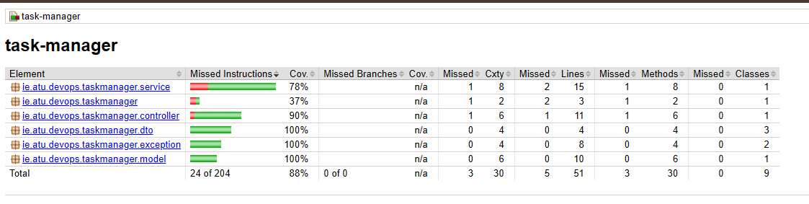

#### GitHub Actions CI

The Java workflow is defined in `.github/workflows/ci.yml`. It uses Java 21,<br/>
Maven verification, and the JaCoCo 80% coverage gate.

| Validation                               | Result        |
|------------------------------------------|---------------|
| Local actionlint validation              | ![PASS][pass] |
| GitHub Actions run `44083764858`         | ![PASS][pass] |
| Test and coverage report artifact upload | ![PASS][pass] |

The workflow handles PRs and branch pushes and uploads test artifacts.

#### SonarQube Static Analysis

SonarQube identified a reliability issue (`java:S9427`) in an API test. A Java<br/>
`assert` was replaced with JUnit `assertNotNull()`. Re-analysis confirmed the<br/>
issue was resolved.

**Before: Reliability D, 1 open issue**


**After: Reliability A, 0 open issues**


| Validation                   | Result        |
|------------------------------|---------------|
| SonarQube Quality Gate       | ![PASS][pass] |
| Coverage: 90.2%              | ![PASS][pass] |
| Duplications: 0.0%           | ![PASS][pass] |
| Reliability A, 0 open issues | ![PASS][pass] |

#### Dependency and Workflow Security

Resolved dependency updates were verified locally: H2 `2.5.252`, json-smart<br/>
`2.6.1`, and ASM `9.11.1` in test scope. Jackson Databind `3.1.7` was retained.

Workflow security and maintenance controls include:

- Explicit minimal job permissions (`contents: read`).
- Full commit SHA pinning for GitHub Actions dependencies.
- Concurrency groups to cancel superseded CI runs.
- Dependabot configuration for Maven, Docker, and GitHub Actions.
- Weekly dependency update checks and reviewable update requests.

Dependabot created four update PRs after the Docker work was merged into<br/>
`master`. Each PR was checked by the existing CI workflows.

#### Docker Containerisation and Security Scanning

A three-stage Dockerfile packages the Task Manager application:

1. **Build:** Maven and Java 21 compile and verify the application.
2. **Extract:** Spring Boot extracts the layered executable JAR.
3. **Runtime:** Java 21 JRE runs without Maven, JDK, or project sources.

Separating application code and dependencies improves image layer caching.

**Runtime security contract:**

- Non-root application user and group: `10001:10001`.
- Read-only root filesystem.
- All Linux capabilities dropped.
- Privilege escalation disabled with `no-new-privileges`.
- Writable `/app/tmp` with `rw,nosuid,noexec` tmpfs restrictions.
- Localhost-only published host port during smoke testing.

#### Trivy Container Security Scan

Trivy 0.76.2 scanned the image and Java dependencies. No HIGH or CRITICAL<br/>
vulnerabilities were detected in the verified scan. The security gate returned<br/>
exit code 0.


| Validation                           | Result        |
|--------------------------------------|---------------|
| Local image build and layered JAR    | ![PASS][pass] |
| Local Trivy scan                     | ![PASS][pass] |
| No HIGH or CRITICAL findings         | ![PASS][pass] |
| Trivy security gate (`exit-code: 1`) | ![PASS][pass] |
| GitHub Actions run `44162103286`     | ![PASS][pass] |

The cited GitHub Actions run verifies Docker build and Trivy scanning, not the<br/>
newer runtime smoke-test step.

#### Docker Runtime Smoke Tests

The Docker security workflow calls `scripts/docker/smoke-test.sh` against the<br/>
image built earlier in the same job. Test logic remains in a reusable Bash<br/>
script rather than embedded inside the GitHub Actions YAML.

The script verifies the image user and Docker runtime configuration, starts the<br/>
application on a dynamically allocated localhost port, checks the HTTP<br/>
endpoints, and removes the test container on exit.

| Local validation (18 November 2026) | Result        |
|-------------------------------------|---------------|
| Bash syntax                         | ![PASS][pass] |
| Docker image build                  | ![PASS][pass] |
| Non-root image user                 | ![PASS][pass] |
| Runtime security restrictions       | ![PASS][pass] |
| Dynamic host port discovery         | ![PASS][pass] |
| Spring Boot `/actuator/health`      | ![PASS][pass] |
| REST API `GET /api/tasks`           | ![PASS][pass] |

The security checks use `docker inspect`. On failure, the script prints<br/>
container logs and removes the temporary container.

The API check is a smoke test, not full JSON schema validation. The runtime<br/>
smoke test passed in GitHub Actions.

#### Docker Runtime Smoke Test Evidence

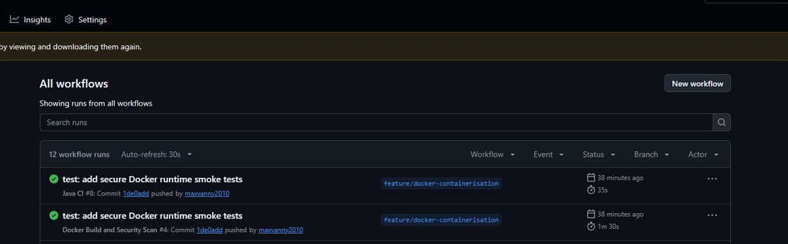


#### Negative Docker Runtime Tests

The separate workflow `.github/workflows/docker-negative-tests.yml` runs only<br/>
when started manually from GitHub Actions. It builds the image and runs<br/>
`scripts/docker/negative-tests.sh`.

| Scenario               | Observed failure       | Result        |
|------------------------|------------------------|---------------|
| Incorrect UID          | Exit 1; UID mismatch   | ![PASS][pass] |
| Invalid container port | Exit 1; rejected value | ![PASS][pass] |
| Missing API endpoint   | HTTP 404; exit 22      | ![PASS][pass] |

All three cases passed in the manual GitHub Actions run on 18 November 2026.<br/>
Each test checked the actual exit code and error message, rather than accepting<br/>
a printed `PASS` alone.


#### Dependabot Update Verification

Dependabot opened four update PRs after the Docker changes reached `master`.<br/>
The PRs triggered the same Java and Docker checks as other code changes. No<br/>
dependency update was merged as part of this review.

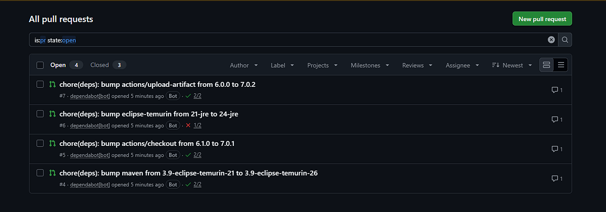

One proposal, PR #6, changed the runtime image from Java 21 to Java 24. Java CI<br/>
passed, but the Docker scan failed. Trivy reported 16 HIGH findings and no<br/>
CRITICAL findings in the Ubuntu 24.04 image. The scan returned exit code 1,<br/>
leaving the PR with a failing check.

| PR #6 validation                    | Observed result             |
|-------------------------------------|-----------------------------|
| Java CI                             | ![PASS][pass]               |
| Docker build and runtime smoke test | ![PASS][pass]               |
| Trivy scan                          | 16 HIGH, 0 CRITICAL; exit 1 |
| Security gate                       | Failed the Docker CI check  |

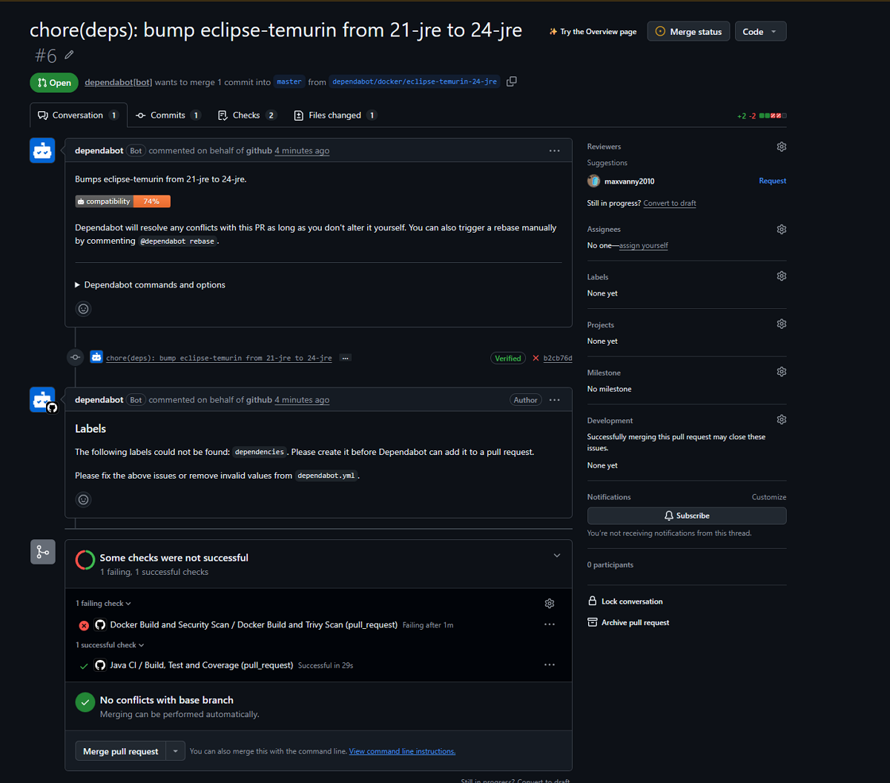

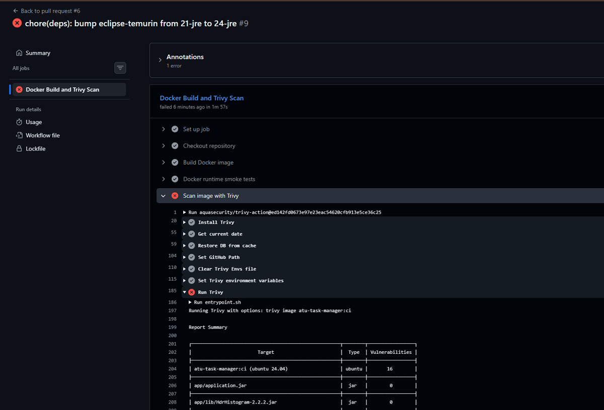

A failed check does not by itself prevent someone from pressing Merge.<br/>
Enforcing a merge block requires a branch ruleset or protection rule.

#### Monitoring and Logging

The delivery architecture includes Spring Boot Actuator and Micrometer,<br/>
Prometheus metrics collection, Grafana dashboards, structured logs, alerts, and<br/>
Slack notifications. Their end-to-end deployment and verification have not yet<br/>
been completed.

#### Assignment Requirements and Evidence

| Assessment criterion               | Marks | Evidence                       |
|------------------------------------|------:|--------------------------------|
| Source Code Management             |    10 | Git history and Pull Requests  |
| Automated Builds and Testing       |    20 | CI results and test reports    |
| Static Analysis and Security       |    15 | Quality and scan reports       |
| Containerisation and Orchestration |    20 | Docker and Kubernetes evidence |
| Deployment                         |    20 | CD runs and deployment checks  |
| Monitoring and Logging             |    15 | Dashboards, alerts, and logs   |

Only observed results are described as verified.

#### Documentation

- [Architecture](docs/ARCHITECTURE.md)
- [Reflection Notes](docs/REFLECTION_NOTES.md)

#### References

- [GitHub Actions](https://docs.github.com/en/actions)
- [JaCoCo Maven Plugin](https://www.jacoco.org/jacoco/trunk/doc/maven.html)
- [GitHub Engineering: Dependabot][github-dependabot]
- [Reddit Engineering: Dependency management][reddit-dependencies]
- [GitHub Dependabot Documentation][dependabot-docs]

Reddit Engineering describes previous Dependabot usage and migration to<br/>
Renovate; it is not evidence of current Reddit production use of Dependabot.

#### Playwright CI Failure and Fix Evidence

The first Playwright GitHub Actions run passed three of four tests. The<br/>
completion test failed because it checked the API state before waiting for the<br/>
asynchronous HTTP PATCH response.

The test was updated to wait for the matching PATCH response before verifying<br/>
the persisted task status.

| Verification               | Result              |
|----------------------------|---------------------|
| Initial GitHub Actions run | FAIL: 3/4           |
| Repeated completion test   | PASS: 10/10 locally |
| Full E2E suite after fix   | PASS: 4/4 locally   |
| GitHub Actions after fix   | PASS: 4/4 E2E       |


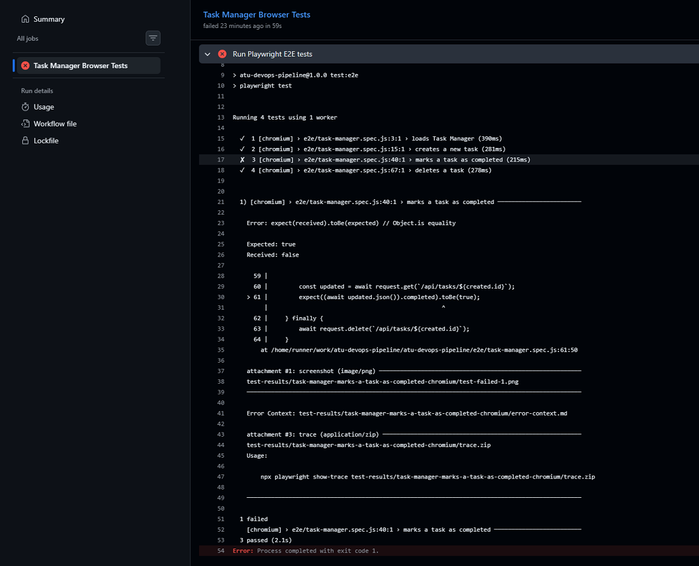


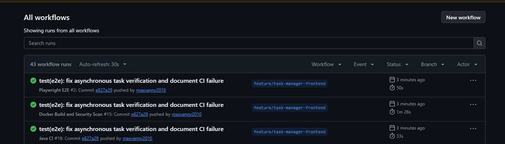

#### Development Status and Limitations

Backend tests, quality checks, Docker build, positive smoke tests, Trivy<br/>
scanning, and manual negative tests are verified in GitHub Actions. Dependabot<br/>
PR creation is verified. Frontend E2E tests passed locally (4/4) and in GitHub<br/>
Actions. Release `v0.1.1` was verified and published to GHCR. The first local<br/>
Kubernetes rollout and API health checks passed, but the published `v0.1.1`<br/>
image lacked the frontend. A corrected image was verified locally; Kubernetes<br/>
frontend deployment, rollback, supply-chain attestations, and observability<br/>
remain unverified.

[pass]: https://img.shields.io/badge/PASS-2ea44f?style=flat-square

[github-dependabot]: https://github.blog/engineering/platform-security/

[reddit-dependencies]: https://www.reddit.com/r/RedditEng/

[dependabot-docs]: https://docs.github.com/en/code-security

### Release automation scripts

The release workflow controls the order of the Verify and Publish jobs. Longer<br/>
Bash commands are stored in `scripts/release/` so they can be checked without<br/>
running a release. They can be syntax-checked independently with `bash -n` and<br/>
ShellCheck.

The Verify job runs Maven/JaCoCo, Playwright, Docker smoke tests, and Trivy.<br/>
After the security gate, it exports the tested Docker image as an artifact. The<br/>
Publishing job checks the master SHA again, verifies the transferred archive<br/>
checksum, loads that image without rebuilding, pushes GHCR version and commit<br/>
SHA tags, and creates the GitHub Release with its image digest.

A release is triggered by a stable SemVer tag such as `v0.1.0` pointing to the<br/>
current `master` commit. No image is published from pull requests. The workflow<br/>
was verified by the successful `v0.1.1` release on 19 November 2026.

### Release Security Hardening and Offline Checks

The release pipeline uses a separate read-only Verify job and a privileged<br/>
Publishing job. The candidate image name is configured once in `release.yml`.<br/>
Verify runs Java, Playwright, Docker smoke tests and Trivy. Its image is saved<br/>
with an image ID, and both files are covered by SHA-256 checksums. Publish<br/>
checks the transferred image ID, full Git revision and source label.

Before publication, the pipeline refuses an existing GitHub Release or GHCR<br/>
version/SHA tag and checks the current master commit again. These preflight<br/>
checks reduce accidental overwrites, but do not guarantee registry-level tag<br/>
immutability against concurrent writers.

Run the offline checks without cloud access:

```bash
bash scripts/release/test-release-scripts.sh
```

Also run `actionlint .github/workflows/release.yml` and syntax checks for all<br/>
release scripts. The tests use mocked services. Real release</br> verification<br/>
was later completed by the successful tagged `v0.1.1` run.

### Automated Release Script Tests

The separate `.github/workflows/release-tests.yml` runs Bash syntax checks and<br/>
`scripts/release/test-release-scripts.sh` on Ubuntu 24.04 for feature-branch<br/>
pushes and pull requests to `master`. The tests use mocked GitHub API and<br/>
Docker commands, so they do not publish images or create GitHub Releases.

The test suite checks both valid inputs and expected failures, including<br/>
invalid release tags, incorrect master SHAs, existing release targets,<br/>
incorrect image metadata, and a modified archive. An expected script rejection<br/>
counts as a passing negative test.

**Verification (19 November 2026):** Local Bash syntax and offline tests<br/>
passed, `actionlint` passed, and the **Release Script Validation** job passed<br/>
in GitHub Actions. The Docker Security job initially failed while resolving a<br/>
Maven parent POM; a rerun passed. The cause of the initial Maven failure was<br/>
not confirmed.

**GitHub Actions: Release Script Validation — PASS (19 November 2026).**

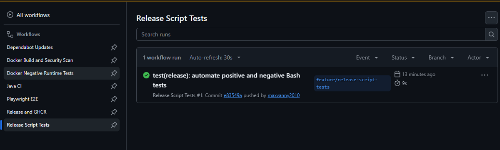

### First Published Release - v0.1.1

**19 November 2026 - Release and GHCR: PASS.**

The first attempt, `v0.1.0`, stopped at the Trivy security gate. Trivy found a<br/>
HIGH vulnerability in the Pebble binary in the original Java 21 runtime image.<br/>
No package was published by that failed run.

I changed the extract and runtime stages to `eclipse-temurin:21-jre-noble`. The<br/>
new image passed a complete local Trivy scan with 0 HIGH and 0 CRITICAL<br/>
findings. GitHub Actions then passed the Docker checks for PR #12. The Docker<br/>
CI run on `master` initially failed while downloading a Maven dependency, but<br/>
passed when rerun.

After merging PR #12, I created the `v0.1.1` tag on `master`. GitHub Actions<br/>
completed both release jobs and published the tested Docker image to GHCR. The<br/>
GitHub Release records the source commit and immutable image digest.

| Release evidence       | Verified result                         |
|------------------------|-----------------------------------------|
| [Release workflow][rw] | `v0.1.1` PASS                           |
| [Container package][c] | Public, `v0.1.1` and `sha-8a5f21a3d9db` |
| [GitHub Release][gr]   | Published, commit `8a5f21a`             |

Pull the published image:

```bash
docker pull ghcr.io/maxvanny2010/atu-devops-pipeline:v0.1.1
```

**Release workflow - successful run:**

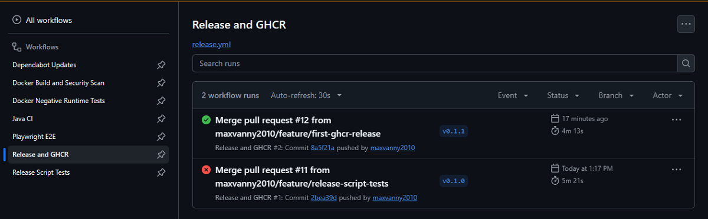

**Published image in GitHub Container Registry:**

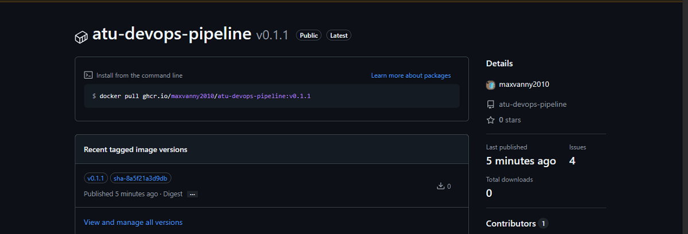

**GitHub Release with source commit and image digest:**

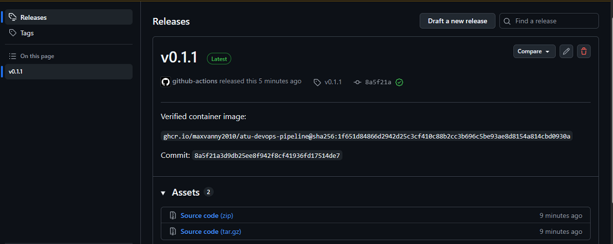

### Kubernetes and Kustomize Implementation

The Kubernetes configuration is stored in `k8s/`. I used Kustomize to share one<br/>
Deployment and Service between local and production configurations without<br/>
copying the same YAML files.

- `k8s/base/` contains the shared Deployment and Service.
- `k8s/overlays/release/` defines the GHCR image and version `v0.1.1`.
- `k8s/overlays/local/` configures the local environment.
- `k8s/overlays/prod/` configures the production environment.

Both environments currently use one replica because the application uses an<br/>
embedded H2 database. Running multiple independent replicas would not provide<br/>
shared application data.

The Deployment runs as non-root, disables privilege escalation, uses a<br/>
read-only root filesystem, drops Linux capabilities, and configures startup,<br/>
readiness, and liveness probes.

A memory-backed `emptyDir` provides writable temporary storage at `/app/tmp`.

#### Kubernetes Validation

Build the generated manifests without starting a cluster:

```powershell
kubectl kustomize k8s/overlays/local
kubectl kustomize k8s/overlays/prod
```

The GitHub Actions workflow `.github/workflows/kubernetes-validation.yml`<br/>
builds both overlays and checks the expected image, replica count, Kubernetes<br/>
resources, health probes, and key security settings.

**Local verification (19 November 2026):**

- Local Kustomize build: PASS.
- Production Kustomize build: PASS.
- GitHub Actions workflow syntax (`actionlint`): PASS.

These checks alone do not prove that the application runs in Kubernetes. A<br/>
later local rollout of the published `v0.1.1` image completed with one Ready<br/>
Pod; health and REST API returned HTTP 200. The frontend returned HTTP 404,<br/>
which led to the packaging fix documented below. The corrected image still<br/>
needs a new release and Kubernetes verification. Rollback has not yet been<br/>
tested.

#### Kubernetes Cluster Deployment Evidence

**Local deployment (19 November 2026):**

- Docker Desktop Kubernetes v1.36.1 was active.
- The `docker-desktop` control-plane node was Ready.
- The `task-manager` Deployment successfully rolled out (1/1 Ready).
- The Pod was Running with zero restarts.
- The `task-manager` ClusterIP Service exposed port 8080.
- Health and REST API endpoints returned HTTP 200.

These screenshots show the initial `v0.1.1` rollout, not the corrected image.<br/>
The missing frontend was diagnosed and fixed separately in the local image. A<br/>
Kubernetes rollout of the corrected image remains pending.

**Kubernetes cluster and node readiness:**

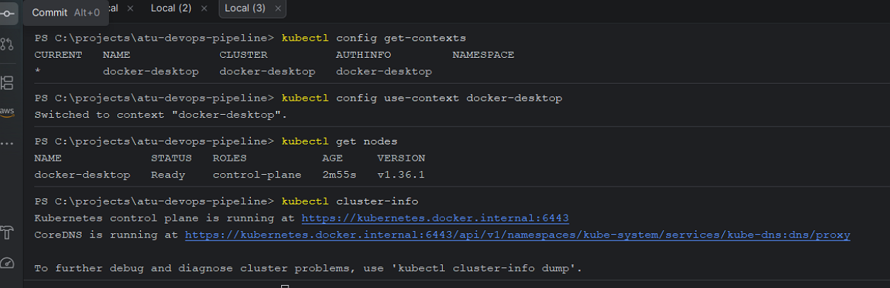

**Successful Deployment rollout and Pod readiness:**

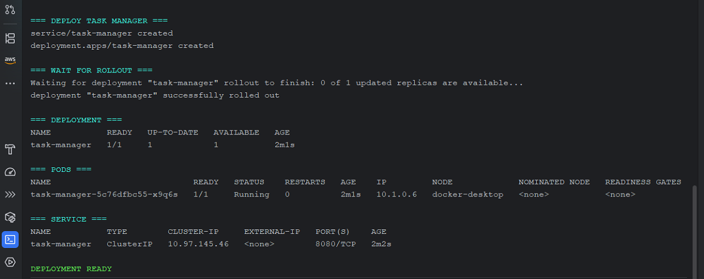

**Docker Desktop Kubernetes overview:**

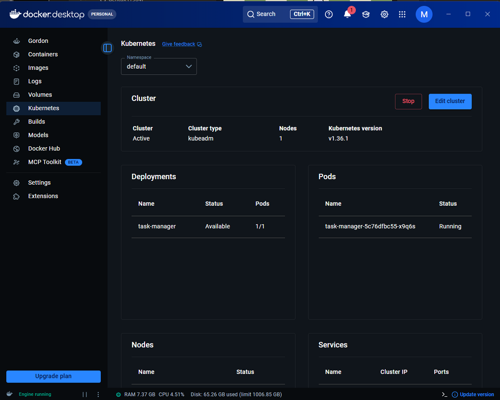

#### Kubernetes Validation Script Refactoring

The Kubernetes workflow originally contained inline Bash for downloading<br/>
`kubectl`, verifying its SHA-256 checksum, building Kustomize overlays and<br/>
checking security settings. I moved this logic into reusable scripts:

- `scripts/k8s/install-kubectl.sh` installs `kubectl` v1.36.1 on the CI runner<br/>
  and verifies the downloaded binary against its published SHA-256 checksum.
- `scripts/k8s/validate-manifests.sh` builds the release, local and production<br/>
  manifests and validates their image, replica count, probes and security<br/>
  settings.
- `.github/workflows/kubernetes-validation.yml` now runs these scripts and<br/>
  includes `scripts/k8s/**` in its path filters.

This keeps workflow orchestration separate from validation logic, as in the<br/>
release pipeline. The expected image is extracted from the release overlay,<br/>
so updating the image tag does not require editing the validation script.

Run the validation locally with Git Bash:

```powershell
& 'C:\Program Files\Git\bin\bash.exe' scripts/k8s/validate-manifests.sh
```

**Local results (19 November 2026):** Bash syntax PASS for both scripts;<br/>
`actionlint` PASS; local and production Kustomize validation PASS; all new<br/>
files within 90 characters per line; staged whitespace check PASS.

The new `install-kubectl.sh` was syntax-checked locally but not executed.<br/>
The refactored workflow still requires GitHub Actions verification on Ubuntu.

The `.gitattributes` rule `scripts/k8s/*.sh text eol=lf` keeps both Bash files<br/>
with LF line endings and avoids Windows CRLF problems.

#### Kubernetes References

- [Kubernetes Kustomize documentation][kd]
- [Kubernetes Deployments][dp]
- [Kubernetes Services](https://kubernetes.io/docs/concepts/services-networking/service/)
- [Kubernetes health probes][p]
- [GitHub Actions documentation](https://docs.github.com/en/actions)

### Docker Frontend Packaging Fix

During the first local Kubernetes deployment, the Task Manager Pod was running<br/>
and the health endpoint and REST API returned HTTP 200. However, the frontend<br/>
returned HTTP 404.

I found that `.dockerignore` excluded `src/main/resources/static` from the<br/>
Docker build context. The Maven build contained the frontend files, but the<br/>
published `v0.1.1` Docker image did not. I removed that exclusion and also<br/>
removed the unnecessary exclusion for `src/main/resources/templates`.

I rebuilt the Docker image locally and extended the existing<br/>
`scripts/docker/smoke-test.sh` to check `/`, `/index.html`, `/styles.css` and<br/>
`/app.js` in addition to container security, application health and the REST<br/>
API.

#### Local Verification (19 November 2026)

| Check                                        | Observed result                 |
|----------------------------------------------|---------------------------------|
| Maven build and nine tests                   | PASS                            |
| Rebuilt Docker image                         | PASS                            |
| Non-root user and runtime security           | PASS                            |
| Spring Boot health and REST API              | HTTP 200                        |
| `/`, `/index.html`, `/styles.css`, `/app.js` | HTTP 200                        |
| Old GHCR image `v0.1.1`                      | Expected FAIL: HTTP 404, exit 1 |

The negative test showed that the updated smoke test rejects the old image<br/>
specifically because the frontend is missing. The same smoke test is called by<br/>
Docker CI and the release workflow, so this check will also run during future<br/>
release verification.

The corrected image has been verified locally, but **has not yet been published<br/>
as a new GHCR release or redeployed to Kubernetes**. The published `v0.1.1`<br/>
image remains unchanged. GitHub Actions has not yet verified the updated smoke<br/>
test.


[rw]: https://github.com/maxvanny2010/atu-devops-pipeline/actions/workflows/release.yml

[c]:https://github.com/maxvanny2010/atu-devops-pipeline/pkgs/container/atu-devops-pipeline

[gr]: https://github.com/maxvanny2010/atu-devops-pipeline/releases/tag/v0.1.1

[kd]: https://kubernetes.io/docs/tasks/manage-kubernetes-objects/kustomization/

[dp]: https://kubernetes.io/docs/concepts/workloads/controllers/deployment/

[p]: https://kubernetes.io/docs/concepts/configuration/liveness-readiness-startup-probes/

### Immutable Kubernetes Image Updates

Kubernetes uses an immutable GHCR image digest rather than a mutable image tag.
GitHub Release tags remain useful for identifying application versions.

The reusable `scripts/release/update-kustomize-image.sh` accepts a full image
reference and updates the release overlay. It validates the repository and
SHA256 digest before changing the file. Repeated updates are safe.

Run offline tests:

```bash
bash scripts/release/test-kustomize-image.sh
```

Automated integration with GitHub Actions is planned for the next iteration.

### Release v0.1.2 Evidence

The `v0.1.2` GitHub Actions release workflow passed both verification and
publishing jobs. GitHub Release records commit `31b3b28` and the published
container image digest.

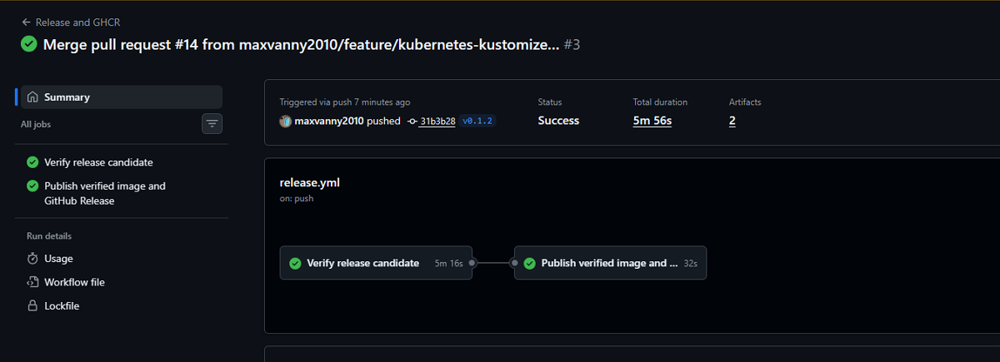

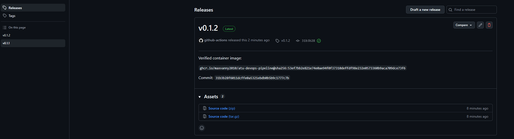

Local Kubernetes application checks returned HTTP 200 for the frontend,
HTML, CSS, JavaScript and REST API. The health endpoint returned `UP`.
These checks confirm that the earlier missing-frontend issue was fixed.
The screenshot does not independently verify a digest-based rollout.

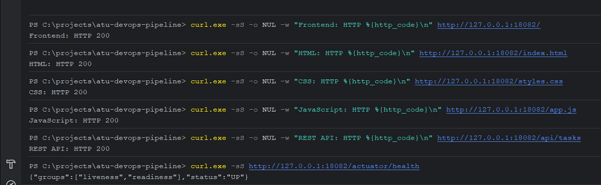

### Automated Digest Release Pull Requests

After a verified GHCR release, GitHub Actions proposes a Kustomize image<br/>
update. The script reads `PUBLISHED_IMAGE` and creates a PR against the latest<br/>
`master`. It uses an immutable SHA256 digest instead of editing version tags<br/>
manually. Kubernetes manifest validation is dispatched for the new branch.<br/>
The PR requires manual review and merge; it does not deploy the image.

Offline tests use a temporary local Git repository and mocked GitHub CLI<br/>
commands. No real GitHub PR or release is created during these tests.

```bash
bash scripts/release/test-create-kustomize-pr.sh
```

GitHub Actions keeps read-only token permissions by default. The repository<br/>
setting allows Actions to create pull requests. The release job explicitly<br/>
grants the permissions required for publishing, PR creation and validation.<br/>
These permissions do not automatically approve or merge a PR.

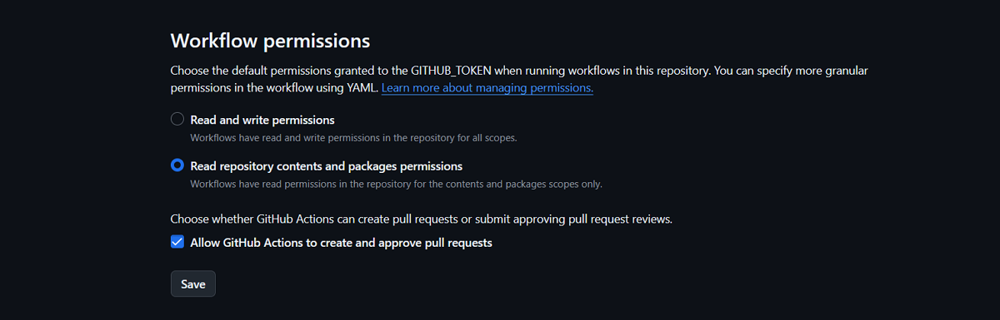

### Kubernetes Rollback Verification

On 21 November 2026, I tested a failed local Kubernetes update. The<br/>
Deployment initially ran `v0.1.2` with one Ready replica. I temporarily<br/>
selected a nonexistent image and observed `ErrImagePull`. I then ran<br/>
`kubectl rollout undo --to-revision=4`. Kubernetes restored the working<br/>
`v0.1.2` image and completed the rollout as revision 6.

After recovery, the frontend, static files, REST API and Actuator health<br/>
endpoint each returned HTTP 200. The health status was `UP`.

The original `last-applied-configuration` annotation still referenced<br/>
`v0.1.1`. This is a limitation of imperative rollback: inspect the current<br/>
declarative configuration before a later `kubectl apply`.

A read-only verification script checks the image, Deployment readiness and<br/>
six HTTP endpoints after a rollback. Start a port-forward in another shell:

```powershell
kubectl -n default port-forward deployment/task-manager 18080:8080
```

Then run the verification and its offline mock tests:

```powershell
powershell -NoProfile -File scripts/k8s/verify-rollback.ps1
powershell -NoProfile -File scripts/k8s/test-verify-rollback.ps1
```

The read-only script does not perform a rollout or modify the cluster.

**Rollback evidence:**

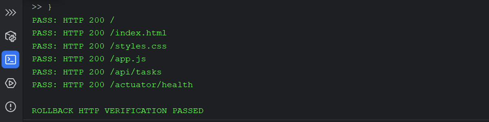

**Test scripts:**

- `verify-rollback.ps1` - Read-only post-rollback verification test.
- `test-verify-rollback.ps1` - Offline tests using mocked Kubernetes
  and HTTP responses.

These scripts are used for testing and demonstration only.<br/>
They do not perform rollback or modify Kubernetes resources.
