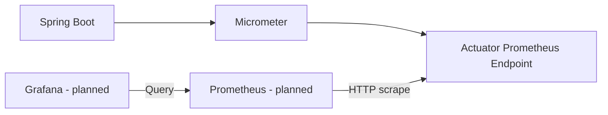

### CI/CD Pipeline Architecture

**Atlantic Technological University (ATU)**

**Programme:** Postgraduate Diploma in Computing in DevOps<br/>
**Module:** DevOps Software Engineering<br/>
**Lecturer:** Maria Griffin<br/>
**Student:** Maksym Voronianskyi<br/>
**Student Number:** L00213593<br/>
**Academic Year:** 2026/2027

**Technologies:** Java 21, Spring Boot, Spring Data JPA, H2, Maven,<br/>
JUnit, Mockito, JaCoCo, HTML, CSS, JavaScript, Playwright, GitHub<br/>
Actions, SonarQube, Trivy, Dependabot, Docker, Docker Compose, GHCR,<br/>
Kubernetes, Kustomize, Terraform, Actuator, Micrometer, Prometheus,<br/>
Grafana, Slack, SBOM, Software Provenance, Image Signing, Semantic<br/>
Versioning

---

## Overview

The DevSecOps architecture supports automated verification and<br/>
controlled delivery of a small Java Spring Boot Task Manager<br/>
application. The main focus is reproducibility, security,<br/>
deployment, reliability, and observability.

## Application Architecture

| Component | Technology                 | Responsibility               |
|-----------|----------------------------|------------------------------|
| Backend   | Java 21, Spring Boot       | REST API and business logic  |
| Data      | Spring Data JPA, H2        | Persistence                  |
| Frontend  | HTML, CSS, JavaScript      | Browser-based task interface |
| Build     | Maven                      | Dependency management        |
| Testing   | JUnit, Mockito, Playwright | Automated verification       |

### Implemented Backend

The backend uses Spring MVC controllers, service components, Spring<br/>
Data JPA repositories, and H2. Bean Validation checks requests;<br/>
centralised exception handling returns HTTP 400/404 where<br/>
applicable.

Four service unit tests, four MVC API integration tests, and one<br/>
context load test passed on Java 21 and Spring Boot 4.1.2. The<br/>
frontend is implemented with HTML, CSS, and JavaScript and served<br/>
from Spring Boot's static resource directory.

### Browser Interface and API Flow

The static frontend loads at `/` from `static/index.html`. Its<br/>
JavaScript uses relative `/api/tasks` URLs, so the page and API share<br/>
the Spring Boot origin. The browser does not need CORS or a separate<br/>
frontend build process.

```text
Browser (HTML, CSS, JavaScript)
       |
       | HTTP: GET, POST, PATCH, DELETE /api/tasks
       v
Spring Boot TaskController
       |
       v
TaskService -> Spring Data JPA -> H2
```

The form submits a task title. Each list item includes a completion<br/>
checkbox and a delete action. After a successful mutation, the browser<br/>
reloads the list from the API. User-entered titles are inserted as<br/>
text rather than HTML.

### Playwright E2E Test Architecture

`e2e/task-manager.spec.js` uses Chromium against the real Spring Boot<br/>
application on `http://127.0.0.1:8081`. The tests verify page loading,<br/>
creating a task, changing its completed state, and deleting a task.<br/>
Tests that create data use API requests to clean it up.

```text
Playwright (Chromium)
       |
       v
Task Manager page -> Spring Boot REST API -> H2
       |
       +--> Browser assertions
       +--> API state assertions
```

| Local check (18 November 2026) | Result        |
|--------------------------------|---------------|
| Four Chromium E2E tests        | ![PASS][pass] |
| JavaScript syntax              | ![PASS][pass] |
| Playwright test discovery      | ![PASS][pass] |
| `actionlint` on Playwright CI  | ![PASS][pass] |

**Result:** 4/4 browser tests passed in 8.4 seconds. The workflow is<br/>
verified in GitHub Actions after a Playwright timing fix.

### Playwright CI Workflow

`.github/workflows/playwright.yml` is separate from Java CI and Docker<br/>
CI. It runs on feature-branch pushes, PRs targeting `master`, and<br/>
manual dispatch. The Ubuntu job:

1. Checks out the repository with read-only permissions.
2. Configures Java 21 and Node.js 22.
3. Runs `npm ci` and installs Chromium with system dependencies.
4. Builds the Spring Boot JAR with Maven.
5. Starts the application on port 8081.
6. Polls `/actuator/health` until it responds or times out.
7. Runs four Playwright tests and uploads reports and the server log.

The Maven build remains part of this job because the browser needs a<br/>
running backend. The separate Java CI job still enforces its own<br/>
coverage gate. The Playwright job passed in GitHub Actions.

## Code Coverage and Quality Gates

JaCoCo 0.8.16 generates reports during Maven verification. The build<br/>
enforces a minimum of 80% instruction coverage.

| Validation                   | Result        |
|------------------------------|---------------|
| Nine automated tests         | ![PASS][pass] |
| JaCoCo coverage: 88%         | ![PASS][pass] |
| Minimum coverage gate: 80%   | ![PASS][pass] |
| SonarQube Quality Gate       | ![PASS][pass] |
| Reliability A, 0 open issues | ![PASS][pass] |

SonarQube analysis confirmed 90.2% coverage and 0.0% code<br/>
duplication.

## CI Architecture

Pull Request validation and release/deployment operations run in<br/>
separate trust contexts.

```text
                     GitHub Pull Request
                              |
                              v
                        CI Validation
                              |
              +---------------+---------------+
              |               |               |
              v               v               v
         Java Tests      Code Quality     Docker Tests
              |               |               |
              +---------------+---------------+
                              |
                              v
                       Security Gates
                         /        \
                      PASS        FAIL
                       |            |
                       v            v
                  Merge eligible   Failed check
```

A failing check is visible to reviewers. Blocking merge requires<br/>
a branch protection rule or ruleset that requires the check.

### Implemented Workflows

- Java CI builds, tests, and enforces the JaCoCo threshold.
- Playwright CI builds the app and runs Chromium browser tests.
- Docker CI builds the image and executes Trivy vulnerability
  scanning.
- A local Docker runtime smoke test verifies effective security
  settings.
- The Docker workflow includes a call to the reusable smoke-test
  script.
- Workflow permissions are limited to `contents: read`.
- GitHub Actions dependencies use full commit SHA references.
- CI concurrency cancels superseded branch runs.

The Docker runtime smoke-test step passed in GitHub Actions.<br/>
Playwright CI passed locally and in GitHub Actions.

## Docker Build Architecture

The Dockerfile uses three stages:

1. **Build:** Maven compiles and verifies the Java application.
2. **Extract:** Spring Boot extracts the layered executable JAR.
3. **Runtime:** The JRE executes the application as a non-root user.

Layered packaging helps reuse cached dependencies when application<br/>
code changes without modifying the dependency set.

### Docker Runtime Security Contract

| Requirement                    | Docker implementation                |
|--------------------------------|--------------------------------------|
| Non-root process               | `USER 10001:10001`                   |
| Immutable root filesystem      | `--read-only`                        |
| Minimal Linux capabilities     | `--cap-drop ALL`                     |
| No privilege escalation        | `--security-opt no-new-privileges`   |
| Restricted writable storage    | `/app/tmp` tmpfs                     |
| Local testing network exposure | `127.0.0.1` with a dynamic host port |

The `/app/tmp` tmpfs uses `rw,nosuid,noexec` plus explicit UID/GID.<br/>
The configuration is applied when the container starts, not solely<br/>
by building the Docker image.

### Runtime Verification

The CI workflow executes `scripts/docker/smoke-test.sh` after the<br/>
Docker build and before Trivy scanning. GitHub Actions orchestrates<br/>
the step; the Bash script implements the checks.

The script:

1. Verifies the non-root user configured in the built image.
2. Runs the image with read-only filesystem and restricted privileges.
3. Uses `docker inspect` to check effective runtime configuration.
4. Discovers the dynamically assigned localhost host port.
5. Polls `/actuator/health` until Spring Boot reports `UP`.
6. Checks the response to `GET /api/tasks`.
7. Removes the container and prints logs if validation fails.

Runtime values such as image name, UID/GID, timeout, and endpoint<br/>
paths are configurable through environment variables.

| Local verification (18 November 2026) | Result        |
|---------------------------------------|---------------|
| Bash syntax                           | ![PASS][pass] |
| Docker image build                    | ![PASS][pass] |
| Image user                            | ![PASS][pass] |
| Runtime security restrictions         | ![PASS][pass] |
| Dynamic localhost port                | ![PASS][pass] |
| Spring Boot health endpoint           | ![PASS][pass] |
| REST API smoke response               | ![PASS][pass] |

**Verification:** Local and GitHub Actions smoke tests passed.

## Release and Supply Chain Architecture

### Versioning and Release Artifacts

| Element            | Configuration                             |
|--------------------|-------------------------------------------|
| Commit convention  | Conventional Commits                      |
| Version scheme     | Semantic Versioning (`MAJOR.MINOR.PATCH`) |
| Version identifier | Git tag (`vX.Y.Z`)                        |
| Release record     | GitHub Release associated with the tag    |
| Image registry     | GitHub Container Registry (GHCR)          |
| Image identity     | Immutable registry digest (`sha256:...`)  |
| Security evidence  | Trivy report, SBOM, provenance, signature |

### Release Flow

```text
Conventional Commits
         |
         v
CI: Tests + Coverage + SonarQube + Docker + Trivy
         |
         v
Approved merge to default branch
         |
         v
Version selection (Semantic Versioning)
         |
         v
Git tag vX.Y.Z
         |
         v
Verify: tests, build, runtime checks, Trivy
         |
         v
Transfer verified Docker image to Publish
         |
         v
Check image and publish to GHCR
         |
         v
Create GitHub Release and record image digest
         |
         v
Deploy verified image by digest
```

### Artifact Promotion

The deployment references the verified GHCR image digest, rather<br/>
than rebuilding the application or relying on a mutable image tag.

## Kubernetes Deployment Architecture

### Workload and Runtime Security

| Component                   | Kubernetes configuration                  |
|-----------------------------|-------------------------------------------|
| Application                 | Deployment                                |
| Internal access             | Service                                   |
| Non-root process            | `runAsNonRoot`, `runAsUser`, `runAsGroup` |
| Read-only root              | `readOnlyRootFilesystem: true`            |
| Capabilities                | `drop: [ALL]`                             |
| Privilege escalation        | `allowPrivilegeEscalation: false`         |
| System-call filtering       | `seccompProfile: RuntimeDefault`          |
| Writable temporary files    | `emptyDir` mounted at `/app/tmp`          |
| Health checks               | Startup, readiness, liveness probes       |
| Environment overlays        | Kustomize                                 |
| Infrastructure provisioning | Terraform                                 |

### Deployment Flow

```text
Verified GHCR image digest
            |
            v
Kustomize environment configuration
            |
            v
Kubernetes Deployment
            |
            +--> Startup probe
            +--> Readiness probe
            +--> Liveness probe
            |
            v
Rollout verification
            |
            +--> PASS: deployment complete
            |
            +--> FAIL: rollback
```

### CI/CD Trust Boundaries

| Pipeline stage      | Access                               |
|---------------------|--------------------------------------|
| Pull Request CI     | Read-only repository access          |
| Release workflow    | Tag and release creation permissions |
| Image publication   | GHCR package write permissions       |
| Deployment workflow | Environment-scoped credentials       |

Deployment workflows are serialised per target environment.

## Negative Docker Runtime Testing

The negative checks use a separate GitHub Actions workflow with only<br/>
`workflow_dispatch`. They do not run on pushes or Pull Requests.

| Component                   | Responsibility                   |
|-----------------------------|----------------------------------|
| `docker-negative-tests.yml` | Manual workflow and image build  |
| `negative-tests.sh`         | Run three expected-failure cases |
| `smoke-test.sh`             | Report failed runtime checks     |

```text
Manual Run workflow
        |
        v
Build Docker image
        |
        v
Run negative-tests.sh
        |
        +-- Incorrect UID
        +-- Invalid port
        +-- Missing API endpoint
        |
        v
Check exit codes and error messages
```

The three scenarios passed in GitHub Actions on 18 November 2026.<br/>
These checks test failure handling; they are not a substitute for<br/>
container vulnerability scanning or runtime security inspection.

## Dependency Update and Security Checks

Dependabot checks Maven, Docker and GitHub Actions dependencies and<br/>
opens separate PRs for proposed updates. Each PR triggers Java CI and<br/>
the Docker workflow, including its Trivy scan.

```text
Dependabot update
       |
       v
   Pull Request
       |
       +--> Java CI
       |
       +--> Docker build --> Runtime smoke test --> Trivy
                                                  |
                                             PASS or FAIL
       |
       v
   Human review and merge decision
```

PR #6 proposed a Java 21 to Java 24 runtime image change. The image<br/>
built and passed its smoke test, but Trivy reported 16 HIGH findings<br/>
in Ubuntu 24.04 and returned exit code 1. The check failed. Branch<br/>
protection is required if failed checks must technically block merge.

## Security Architecture

- Minimum GitHub Actions permissions and full SHA-pinned
  dependencies.
- Dependabot configuration for GitHub Actions, Maven, and Docker.
- SonarQube static quality analysis and Trivy vulnerability scanning.
- Hardened Docker runtime with reduced process and filesystem
  privileges.
- Restricted secrets and separate trust boundaries for deployment.
- Immutable release artifacts and eventual provenance validation.

## Observability

| Component            | Responsibility                         |
|----------------------|----------------------------------------|
| Spring Boot Actuator | Health and application metrics         |
| Micrometer           | Application instrumentation            |
| Prometheus           | Metrics collection                     |
| Grafana              | Operational dashboards                 |
| Application logging  | Structured diagnostic information      |
| Slack                | Pipeline and operational notifications |

## Verification Strategy

Evidence should include both positive and negative outcomes:

- Successful and failed automated tests.
- Coverage thresholds and code quality gate enforcement.
- Vulnerability findings and blocked releases.
- Container build and hardened runtime validation.
- Kubernetes rollout, health checks, and rollback.
- Metrics, dashboard screenshots, and alert notifications.
- Tagged release and immutable artifact traceability.

[pass]: https://img.shields.io/badge/PASS-2ea44f?style=flat-square

### Release workflow orchestration and scripts

`.github/workflows/release.yml` owns triggers, job dependencies, action
permissions, tool setup, third-party actions, and artifact transfer.
`scripts/release/` owns complex Bash operations such as tag validation,
application startup and health checks, image packaging, SHA-256 verification,
registry publication, and GitHub Release creation.

Verify has read-only repository permission. Publish needs write access to
repository releases and GHCR packages. Publishing depends on the successful
Verify job. The checked Docker image is transferred between jobs as an
artifact and loaded without rebuilding, preserving its tested content.
The publish-side checkout is required to access the local shell scripts.

A checksum detects accidental transfer corruption but is not a separate
cryptographic provenance attestation. Real release behavior must be tested
on GitHub Actions before claiming a production-verified release process.

### Release Verification and Publishing Boundaries

The release workflow controls job order; `scripts/release/` contains
the longer Bash commands. An image is built and scanned in Verify, then
stored as a compressed Docker archive. Its SHA-256 checksums and Docker
image ID are uploaded with it.

Publish downloads the artifact without rebuilding it, verifies the file
checksums, and checks the loaded image ID, full Git revision and source
OCI labels. A preflight step refuses existing GitHub Releases and GHCR
tags; a master-SHA check executes immediately before publishing.

The file checksum is not an independent supply-chain attestation, because
it accompanies the image in the same artifact. Tag checks can race with
other registry writers; registry-side immutability or protected releases
would provide stronger enforcement. Partial publication remains possible
if GHCR succeeds but GitHub Release creation fails.

### Immutable Image Deployment Design

GitHub Release tags provide human-readable application versions. Kubernetes
deployments use GHCR manifest digests to reference exact published images.

The release pipeline already captures `PUBLISHED_IMAGE` after a successful
registry push. The reusable Kustomize updater accepts this full image reference.
This separates registry publishing from manifest editing and supports testing.

The next stage will connect publishing to a controlled GitHub Pull Request.
No automatic deployment is implemented by the updater itself.

### Automated Digest Promotion

After Verify passes, Publish uploads the tested image and creates a release.
It then proposes a Kustomize PR using the published immutable digest.
The updater operates on a temporary worktree based on the latest `master`.
The workflow triggers Kubernetes manifest validation explicitly because
PRs created using `GITHUB_TOKEN` do not trigger ordinary PR workflows.
Review and merge remain manual. No deployment is performed by this workflow.
The Publishing job has scoped `contents`, `packages`, `pull-requests` and
`actions` write permissions to publish, create a PR and dispatch validation.

### Rollback and Post-Recovery Verification

The Kubernetes Deployment uses RollingUpdate and one replica. The local<br/>
rollback test changed the image to a nonexistent tag and observed<br/>
`ErrImagePull`. `kubectl rollout undo --to-revision=4` restored `v0.1.2`.<br/>
Kubernetes created revision 6 and kept the existing healthy Pod available.

The post-recovery script checks image identity, one updated Ready replica,<br/>
six HTTP endpoints and Actuator `UP`. It does not mutate Kubernetes.<br/>
Offline tests mock kubectl and HTTP responses to check expected failures.

The `last-applied-configuration` annotation can remain stale after an<br/>
imperative rollback. Future `kubectl apply` operations must use the<br/>
reviewed declarative manifest and account for the saved annotation.<br/>
The deployment currently uses the `v0.1.2` tag; a digest-based rollout<br/>
has not yet been verified in the live cluster.

### Application Metrics and Health Monitoring

The application uses Spring Boot Actuator and Micrometer<br/>
with the Prometheus registry.

The metrics collection flow is:



Application health is separated into liveness and readiness states.<br/>
Kubernetes uses these states to evaluate container health and readiness.

The probe timeout is five seconds to tolerate slower local responses.

Only health and Prometheus endpoints are exposed through Actuator.<br/>
Detailed health information is disabled.

Prometheus metrics may contain operational information and should<br/>
not be exposed publicly without appropriate access controls.

Four real HTTP integration tests verify health and metrics export.<br/>
Prometheus collection and Grafana visualisation remain pending.
